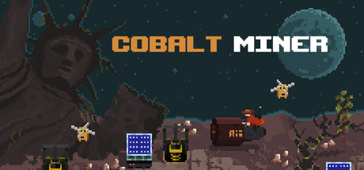

# Cobalt Miner 한국어 패치 1.0.0

[**한글패치 ZIP 다운로드**](https://github.com/KIMDONGWHEE99/cobalt-miner-korean-patch/raw/refs/heads/main/downloads/COBALT_MINER_KOREAN_PATCH_1.0.0_r1.zip) · [게임 소개와 이미지6장](INTRODUCTION.md) · [확인 범위·버전 안내](releases/v1.0.0.md)

Steam 앱 **4601880 / 빌드24347666** 전용입니다. 메뉴·대사397종517위치, 실행 모듈192필드, 이미지12개와 한글 글꼴을 반영했습니다. 영어 언어 슬롯을 한국어로 바꿉니다.

## 설치와 제거

1. 게임을 종료하고 위 ZIP을 다운로드해 새 폴더에 모두 풉니다.
2. `Install.cmd`를 실행하고 Cobalt Miner 설치 폴더를 선택합니다.
3. Steam에서 게임을 실행합니다. 필요하면 설정에서 ‘한국어’를 선택합니다.
4. 제거하려면 같은 ZIP의 `Remove.cmd`를 실행합니다. 중단된 설치도 같은 설치·제거기로 복구합니다.

다른 빌드나 변조 파일에는 강제 적용하지 않습니다. 게임 원본이 필요한 차이 패치이며 게임 전체 파일은 포함하지 않습니다. 폰트와 도구 라이선스는 ZIP의 `licenses` 폴더에 있습니다.

## 확인 범위

확인된 번역 대상의 누락0건, 현재 후보 재추출·글꼴·이미지 변경 경계, 최종 ZIP 설치·복구 검사를 통과했습니다. 사용자 요청으로 추가 조사·화면 검수를 종료한 개인용 버전입니다. 엔진 문구1237개 표시 여부와 전체 시설·도움말·분기는 미확인이며, 전체 G0~G8 통과판이 아닙니다.

검수 사본의 빠른 A엔딩→이어하기→종료 오류는 원본과 후보 모두에서 재현됐고, 대기한 후보 경로는 무오류였습니다. 이전 B엔딩 검수 종료 오류 원인은 미확정입니다. 자세한 내용은 [버전 안내](releases/v1.0.0.md)를 확인하세요.

## 이미지가 포함된 소개글

[게임 소개](INTRODUCTION.md)는 같은 내용의 GitHub용 문서입니다. `미리보기.html`은 이미지 배치를, `카페_복사용.html`은 사진 위치가 표시된 복사용 본문을 제공합니다. HTML을 PC에서 열려면 저장소의 **Code → Download ZIP**으로 문서와 images 폴더를 함께 받아 주세요. 소개 이미지는 공식 영문 홍보 화면입니다.

패치 ZIP SHA-256: `e80c32201aebef5941f723ca017c90dd15721c2720a4701f68f84605cda9d615`
